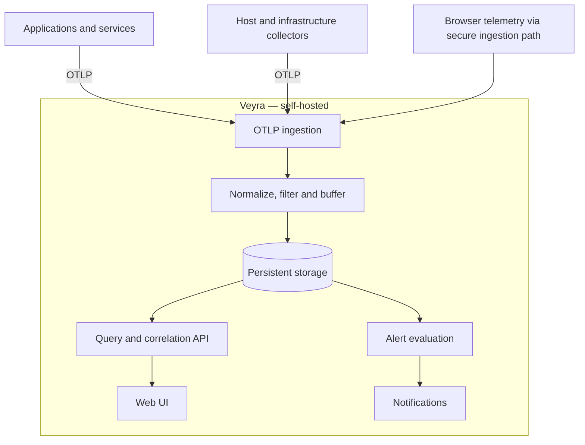

# Veyra

**Open-Source Observability, Simplified.**

Veyra is a lightweight, self-hosted observability platform for understanding the health and behavior of applications, infrastructure, databases, and background jobs—without operating a complex monitoring stack.

> **Status:** Early design / pre-alpha. The features below describe the project vision and proposed roadmap, not an available release.

## Why Veyra?

Monitoring should make problems easier to find, not introduce another system to maintain. Veyra aims to provide a fast, approachable interface for exploring logs, metrics, traces, and incidents, with minimal required services and configuration.

**Design principles**

- **Simple by default:** Target a single Docker Compose deployment (Veyra plus PostgreSQL) with persistent storage.
- **Open standards:** Use OpenTelemetry and OTLP rather than a proprietary ingestion protocol.
- **One coherent experience:** Navigate from system health to an incident, its logs, and related telemetry.
- **Vendor-neutral:** Support cloud, on-premises, Windows, Linux, and containerized workloads.
- **Low overhead:** Favor efficient, buffered ingestion, configurable retention, and selective collection.
- **Modular, not fragmented:** Start with a modular monolith; introduce optional integrations only when justified.

## Planned capabilities

| Area | Goals |
| --- | --- |
| **Logs** | Centralized structured logging, full-text and attribute search, severity filters, exception details, retention controls |
| **Metrics** | Application and host health, CPU, memory, disk, HTTP latency, throughput, and error rates |
| **Traces** | Distributed request timelines and correlation with logs and metrics |
| **Infrastructure** | Windows/Linux hosts, IIS, services, and Docker containers through compatible collectors |
| **Databases** | SQL Server and PostgreSQL health, capacity, backup status, and performance indicators |
| **Jobs & pipelines** | Execution status, duration, last success, throughput, and failures |
| **Alerts** | Configurable rules, incident history, email/webhook notifications |
| **Web UI** | Overview, Log Explorer, Incident Details, and focused service/infrastructure views |

The full list of targets, supported database versions, and retention is in
[`docs/architecture/monitoring-scope.md`](docs/architecture/monitoring-scope.md).

## Architecture (proposed)

Veyra will aim to receive telemetry directly over OTLP where appropriate. Existing OpenTelemetry Collectors remain useful—and sometimes necessary—for host-level collection, buffering, and routing, but Grafana, Loki, Prometheus, Tempo, Seq, Kafka, and Redis are **not intended to be mandatory dependencies**.

### Technology decisions

- **Backend:** ASP.NET Core WebAPI on .NET 10 (LTS), organized as a modular monolith.
- **Ingestion:** OTLP for logs first, with metrics and traces progressively added. Host, container, cloud, and database collection is done by the OpenTelemetry Collector using its existing receivers; Veyra ships tested collector configurations in `integrations/`.
- **Frontend:** React + TypeScript single-page application built with Vite, served by the API, with accessible light and dark themes.
- **Storage:** PostgreSQL, with time-partitioned tables and partition-based retention.
- **Deployment:** Docker Compose (Veyra plus PostgreSQL) with persistent volumes; reverse-proxy and TLS examples included.
- **License:** Apache 2.0.

Each decision is recorded with its context and alternatives in [`docs/adr/`](docs/adr/README.md). The libraries and tools
beyond those decisions are listed in [`docs/architecture/tech-stack.md`](docs/architecture/tech-stack.md).

## Repository layout

| Path | Contents |
| --- | --- |
| [`AGENTS.md`](AGENTS.md) | Conventions and rules for contributors and automated agents |
| [`docs/`](docs/README.md) | ADRs, architecture, guides, integration pages, API reference |
| [`src/`](src/README.md) | Solution, backend modules, frontend |
| [`tests/`](tests/README.md) | Test projects mirroring the backend modules |
| [`integrations/`](integrations/README.md) | OpenTelemetry Collector configurations per monitored target |
| [`samples/`](samples/README.md) | Instrumented sample application and telemetry generator |
| [`deploy/`](deploy/README.md) | Dockerfile, Compose file, reverse-proxy examples |
| [`scripts/`](scripts/README.md) | Build, test, and local-stack helpers |

## MVP roadmap

### v0.1 — Useful logging foundation

- [x] Run Veyra locally with a single Docker Compose command
- [x] Receive structured logs via OTLP
- [x] Persist and query logs by time, severity, service, and attributes
- [x] Search log messages and inspect exceptions/stack traces
- [x] Build Overview, Log Explorer, and Event/Incident Details screens
- [x] Implement basic application/host metrics display
- [x] Add configurable data retention
- [x] Add basic authentication and secure ingestion configuration
- [x] Provide a minimal alerting workflow with email or webhook notifications
- [x] Publish a working .NET sample application and setup guide

### Later milestones

- Distributed tracing and cross-signal correlation
- Windows/IIS, Docker, SQL Server, and PostgreSQL integrations
- Background job and data-pipeline monitoring
- Browser telemetry: Blazor WebAssembly, then React, Angular, and Blazor Server
- macOS hosts, Azure platform services, uptime and certificate checks, and message queues
- Advanced incident workflows, alert routing, and multi-user access
- Optional storage adapters and visual collector configuration

## Security and reliability goals

- Protect ingestion and user-facing APIs with appropriate authentication and TLS.
- Avoid collecting secrets, credentials, or sensitive personal data.
- Use bounded queues, retries, and backpressure policies; document telemetry-loss behavior.
- Make storage retention, backups, and disk usage visible and configurable.
- Keep application instrumentation independent of Veyra-specific SDKs.

## Getting started

Veyra is pre-alpha and has **no released images yet**. It can be built and run from source with Docker Compose;
see [`docs/guides/deployment.md`](docs/guides/deployment.md).

Today it receives logs and metrics over OTLP, stores them in PostgreSQL, and shows them on the Forecast home, in
the Log Explorer, and on the Metrics screens for hosts and services. Accounts have roles and optional two-factor
sign-in, and the Users screen shows each account's sign-ins and sessions; senders use ingestion keys. Built-in
rules raise alerts on a service's error rate and request latency and on a host's disk space and growth, each with
its own details screen; the Alerts screen keeps 90 days of history, and alerts go to webhook and email channels. A
tested Collector configuration watches Linux hosts. Traces and user-defined rules are not built yet.

## Contributing

Feedback, architecture discussions, UI ideas, and contributions are welcome as the project takes shape. Read [`AGENTS.md`](AGENTS.md) for the repository conventions; contribution guidelines and issue templates will follow with the initial codebase.

## License

Veyra is licensed under the [Apache License 2.0](LICENSE).

---

**Veyra** — See the signal. Find the problem.
