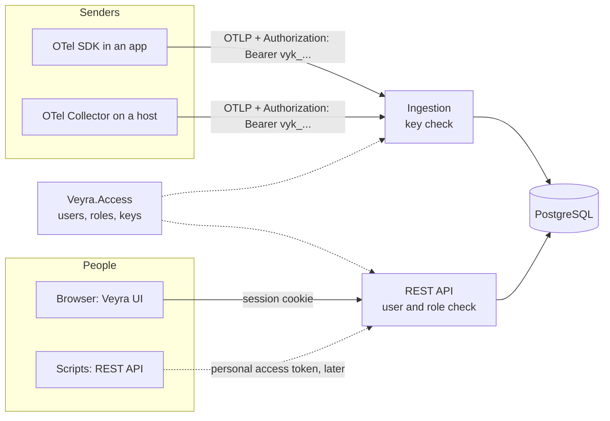

# 0008. Authentication, roles, and ingestion keys

Date: 2026-11-09
Status: Accepted

## Context

Veyra is about to run on a public server, the reference installation. From that moment, anyone on the internet can
reach both of its doors:

- **Senders** push telemetry over OTLP. They are OpenTelemetry SDKs inside applications and OpenTelemetry
  Collectors on hosts. They cannot sign in interactively, and they are configured once and then left alone.
- **People** use the web UI and the REST API to read telemetry and to manage alert rules, groupings, and settings.

The constraints are:

- The owner wants both local accounts and single sign-on, with Microsoft Entra ID as the first provider.
- One installation serves one organisation. Multi-tenancy is not a goal.
- The frontend is served by the API from the same origin (ADR 0004), so the browser and the API share cookies.
- Deployment is two containers behind a reverse proxy (ADR 0006). An extra authentication container would work
  against that.
- Secrets never go into code, configuration files, or documentation (`AGENTS.md`).
- Browser telemetry needs public, write-only keys. That case gets its own ADR and is out of scope here.

## Decision

### 1. Two separate doors

- The OTLP endpoints accept only **ingestion keys**. The REST API and the UI accept only **signed-in users**.
- A key can only write telemetry and can never read anything. A user session can never send telemetry.
- Everything is denied by default. The fallback authorization policy requires a signed-in user. The only
  exceptions are `/healthz`, the sign-in and first-run setup pages, and the OTLP endpoints, which check keys
  instead.

### 2. Ingestion keys

- **Format.** `vyk_` followed by 32 random bytes in base64url. The prefix makes leaked keys easy to find with secret
  scanners.
- **Shown once.** The full key is shown only when it is created. Veyra stores its SHA-256 hash and the first eight
  characters for display. A random 256-bit key needs no slow hash: nobody can guess it, and a fast hash keeps the
  check cheap on every request.
- **Transport.** Senders put the key in the `Authorization: Bearer <key>` header. Every OpenTelemetry SDK can set it
  through `OTEL_EXPORTER_OTLP_HEADERS`, and the Collector can set it through the exporter's `headers` setting. The
  configurations in `integrations/` read it from the `VEYRA_INGEST_KEY` environment variable.
- **Properties.** Each key has a name, the user who created it, a creation time, a last-used time, an optional expiry,
  and a revoked flag.
- **Environments.** A key can optionally be limited to some environments. A record whose
  `deployment.environment.name` is not allowed is rejected and counted in the OTLP partial-success response, so the
  sender learns about it.
- **Checking.** Valid key hashes are cached in memory. A revoked key stops working within 30 seconds.
- **Failures.** A missing or wrong key returns `401` over HTTP and `UNAUTHENTICATED` over gRPC. Failed attempts are
  rate-limited per client address.
- **Management.** Only administrators create, revoke, and list keys.

### 3. Users and sign-in

- **Local accounts.** Each user signs in with an email address and a password.
  - Passwords are hashed with the PBKDF2 password hasher from ASP.NET Core Identity. Veyra uses only the hasher and
    stores users in its own tables through Npgsql, as the rest of Veyra does.
  - Passwords need at least 12 characters.
  - Five failed sign-ins lock the account for 15 minutes.
- **Single sign-on.** OpenID Connect with the authorization code flow and PKCE, using the ASP.NET Core OpenID Connect
  handler.
  - Microsoft Entra ID is the first tested provider. Any compliant provider works through its issuer URL, client ID,
    and client secret.
  - A person is identified by issuer and subject. Their first sign-in creates their Veyra user.
  - Their role comes from a configured mapping of a groups or roles claim, or from a configured default role.
- **Both at once.** Local accounts and single sign-on can be on together. Once single sign-on works, an administrator
  can turn local sign-in off.
- **Multi-factor authentication.** It comes from the single sign-on provider. One-time codes for local accounts are a
  later addition.

### 4. Sessions

- **Cookies.** A signed-in browser holds an ASP.NET Core authentication cookie. The cookie is `HttpOnly`, `Secure`,
  and `SameSite=Lax`. It expires after 8 hours without activity.
- **Why not `Strict`.** A `Strict` cookie is not sent on the redirect back from the single sign-on provider, so a
  person would land on Veyra signed out right after signing in. `Lax` still keeps the cookie off cross-site form
  posts and background requests.
- **No tokens in the browser.** Nothing is stored in `localStorage` or `sessionStorage`. A script injected into the
  page cannot steal a session it cannot read.
- **Cross-site requests.** Every request that changes state must also carry an antiforgery token header. A request
  without it is rejected, even when the cookie is present.

### 5. Roles

Three fixed roles. Each role includes everything the role above it can do.

| Role | Can |
| --- | --- |
| Viewer | See all telemetry, dashboards, alerts, and incidents |
| Editor | Also manage alert rules, groupings, and dashboards, and acknowledge alerts |
| Admin | Also manage users, roles, ingestion keys, and settings |

- Every endpoint declares the lowest role it needs as an ASP.NET Core authorization policy.
- Permissions per environment are a possible later addition and would need a new ADR.

### 6. The first administrator

- On first start with no users, Veyra writes a one-time setup link to its own log. The link contains a random token.
- Whoever opens the link creates the first administrator, either with a local password or by signing in through
  single sign-on.
- The token expires after 24 hours or when it is used, whichever comes first. A restart before setup issues a new
  token.
- There is no default password, and no administrator password in environment variables.

### 7. Ownership

- A new module, `Veyra.Access`, owns users, roles, ingestion keys, and the setup token, in its own `access` schema.
- `Veyra.Core` defines the interface through which `Veyra.Ingestion` checks a key, so Ingestion does not reference
  Access.
- `Veyra.Api` wires the authentication and authorization middleware, as the only composition root.

### 8. Secrets and transport

- **Secrets.** The OpenID Connect client secret and the database connection string come only from environment
  variables, documented in `deploy/.env.example`.
- **TLS.** TLS is terminated by the reverse proxy. Outside the Development environment on localhost, Veyra refuses to
  issue a session cookie over plain HTTP.

### 9. Security events

Veyra writes these events to its own logs as structured records:
- sign-ins that succeed or fail
- lockouts
- key creation and revocation
- rejected keys
- role changes

Veyra stores its own logs, so it can alert on them like any other telemetry.

## Alternatives considered

- **JWT access tokens in the browser.** They are common in single-page apps, but storing tokens where scripts can read
  them exposes sessions to cross-site scripting. Cookies are simpler and safer when the UI and the API share one
  origin.
- **Single sign-on only.** This is simpler, but a small installation or a first run would then need an identity
  provider before anyone could sign in. The owner wants both.
- **An authentication proxy in front of Veyra, such as oauth2-proxy or Authelia.** This keeps sign-in out of the
  code, but it adds a container and its configuration, and it cannot protect OTLP senders.
- **Mutual TLS for senders.** It is strong, but certificates are hard to issue and rotate for many applications.
  Keys are simpler. Mutual TLS can still be added at the reverse proxy by anyone who needs it.
- **ASP.NET Core Identity with its Entity Framework Core stores.** This is a complete solution, but it brings Entity
  Framework Core into a codebase that uses plain SQL. The few tables needed are easy to write directly.
- **A default `admin` account with a known password.** It is convenient, and it is the classic way installations get
  taken over.
- **A slow hash such as Argon2 for ingestion keys.** A slow hash protects human-chosen secrets. Random 256-bit keys do
  not need it, and a slow hash on every OTLP request would cost real CPU.

## Consequences

- **Modules.** `Veyra.Access` joins the module list in `AGENTS.md` and `src/backend/README.md`. ADR 0002 stays
  as it is; this ADR extends its list of modules.
- **Every sender needs a key.** The sample application and every configuration in `integrations/` read
  `VEYRA_INGEST_KEY`. The getting-started guide shows how to create the first key.
- **Frontend screens.** The frontend gains sign-in, first-run setup, users, and ingestion keys screens. Each one
  follows the usual rules: responsive, light and dark themes, keyboard accessible.
- **Tests.**
  - Every endpoint group gets integration tests for `401` without a session and `403` with too low a role.
  - A contract test fails when an endpoint does not declare a policy.
  - The OTLP endpoints get tests for a missing key, a revoked key, and a disallowed environment.
- **Automation.** Scripts that call the REST API need personal access tokens. They are not part of v0.1 and will be
  added under this model, as a third credential that, like a session, belongs to a user and their role.
- **Browser telemetry.** The browser telemetry ADR will add public, write-only keys bound to allowed origins, as a
  second kind of ingestion key.
