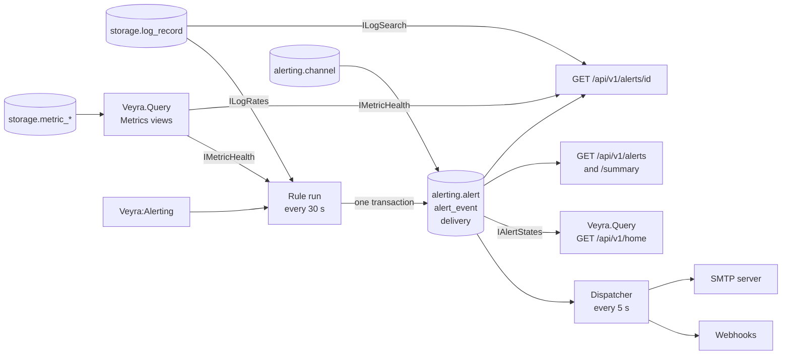

# Alerting

Status: v0.1 has four built-in rules: the error rate of a service's logs, the latency of its HTTP requests, and the
space and growth of a host's disks (ADR 0012). Notifications go to webhook and email channels, and the Alerts screen
lists 90 days of history. User-defined rules and incidents follow.

Alerts are the only source of health on the home dashboards (ADR 0007). A lit service or host always has an alert
behind it, and the alert says why.



`Veyra.Alerting` reads record counts through `ILogRates`, log summaries through `ILogSearch`, and disk and latency
figures through `IMetricHealth`, and offers its alerts through `IAlertStates`, all defined in `Veyra.Core`. It never
references the Storage or Query modules. The Query module implements `IMetricHealth` with the views that draw the
Metrics screens and the home, so an alert and the screen it links to show the same numbers. `Veyra.Api` wires the
interfaces to their implementations.

## What an alert is about

An alert belongs to a **block** (ADR 0007): a **service**, named by `service.name`, or a **host**, named by
`host.name`. It can also name a **part** of its block: the mount point of a disk. Every environment counts
separately, so `orders` in production and `orders` in staging are two services with two alerts, and every disk of a
host has alerts of its own. At most one alert per rule and subject is open at a time; a unique index enforces it.

## The built-in rules

Every 30 seconds Veyra runs every rule that is switched on. Each rule has two thresholds, and an alert that is open
clears only clearly past its threshold (**hysteresis**), so a figure that hovers around a threshold does not open and
close an alert every 30 seconds.

| Rule | Measures | Caution | Warning | A held severity ends |
| --- | --- | --- | --- | --- |
| `error-rate` | Share of a service's log records that are `Error` or worse, last 5 minutes | 1 % | 5 % | Below half its threshold |
| `latency-p95` | 95th percentile of a service's HTTP request durations, last 5 minutes | 1 s | 3 s | Below 80 % of its threshold |
| `disk-space` | Share of a disk in use, now | 90 % | 95 % | 5 points below its threshold |
| `disk-filling` | Days until a disk is full at the pace of the last day | 14 days | 3 days | Past 1.5 times its threshold, or not filling |

- **Too little to judge by.** With fewer than 20 records (error rate) or 20 requests (latency) in the window, nothing
  changes: no alert opens, and an open one keeps its last measurement. One error in a quiet service is not a 100 %
  error rate worth an alert.
- **Silence is no sign of recovery.** A service that stops sending, a host that goes away, or a disk that is no
  longer reported keeps its open alert as it is. It resolves once its figures show it clear again. Marking blocks
  `unknown` when data stops is planned.
- **Which disks.** The disk rules read the Collector's `system.filesystem.usage`. Pseudo file systems such as
  `tmpfs` and `overlay`, and read-only ones, are left out, and a device mounted at several places counts once, under
  its shortest mount point, exactly as on the Metrics screens.
- **Days until full** come from a straight line through the last day's hourly share in use. A disk that grows by
  less than 0.05 points a day, or would be full only in more than a year, is not filling; Veyra records 365 days for
  it. An open `disk-filling` alert clears when its disk stops filling. A full disk that stopped growing still has
  its `disk-space` alert, which is why there are two disk rules.
- **One alert per episode.** An alert keeps its identity and its opening time while its severity rises and falls.
  It records the latest and the worst measurement, and when the worst was measured: the highest, or for days until
  full the fewest.

## Lifecycle and history

An alert opens when its rule first fires and resolves when the rule clears. Every change is an event in
`alerting.alert_event`: opened, escalated (caution to warning), eased (warning to caution), and resolved. The events
are the alert's timeline on its details screen. The alert also keeps the worst severity it ever had, so the history
can say "was warning" for an alert that eased before it resolved.

Resolved alerts are kept for `Veyra:Alerting:HistoryDays`, 90 days by default, for the Alerts screen, the home's
"Resolved since yesterday" list, and the details screen. Older ones are deleted at the start of every rule run,
with their events and notifications. Open alerts are never deleted.

Every alert that opens, changes severity, or resolves is also written to Veyra's own log, at Warning for openings
and changes and at Information for resolutions.

## The Alerts screen

The Alerts screen (`/alerts`) shows the alerts of the last 30 or 90 days, newest first: every alert that was open at
some time in the period. A weather log draws one cell per UTC day with the worst alert that opened that day and how
many opened; alerts opened before the period count on its first day. The list can be narrowed to open or resolved
alerts, to some rules, and to a service, host, or disk by name, and the filters stay in the address. The built-in
rules stand beside it with their thresholds as this installation sets them. Days are UTC days until Veyra knows the
viewer's time zone.

## Notifications

Administrators add channels on the Notifications screen. A channel is a **webhook** (an HTTP POST of JSON) or an
**email** to up to 20 addresses. Each channel chooses which alerts it hears of:

| Event | Who is told |
| --- | --- |
| Opened | Channels that take its severity: warning, caution, or both |
| Escalated to warning | Channels that take warnings |
| Eased to caution | Nobody; it shows on the timeline only |
| Resolved | Channels that were told about the alert and asked for resolutions |

A channel that is switched off receives nothing, and messages queued for it before it was switched off are marked
failed rather than sent later. Deleting a channel deletes its delivery history.

Messages say what is wrong in the words of the rule: "payments-gateway logs 6.2% errors", "checkout-web answers
slowly, p95 3.4 s", "disk /var/log on web-02 is 91% full", "disk / on web-01 is full in 9 days".

### Delivery

The rules never wait for a network call. When an alert changes, the change, its event, and one delivery per channel
that wants it are written in the same transaction, so a change is never stored without its messages. A separate
dispatcher sends them:

- Every 5 seconds it claims up to 10 due deliveries with `FOR UPDATE SKIP LOCKED` and leases them, so a crash
  while sending only delays them.
- Each try has 10 seconds. A webhook counts as delivered on any 2xx answer; redirects are not followed.
- A failed try is retried after 30 s, 1, 2, 5, and 15 minutes: six tries over about 25 minutes. After that the
  delivery has failed for good.
- Failures show on the channel's card and on the alert's timeline, with the reason, and are logged.

Delivery is not on the ingestion path, so a failing channel can never cost telemetry. The number of deliveries is
bounded by the number of alert changes times the number of channels.

A message is sent at least once. If Veyra stops after a receiver accepted a message but before it recorded that, the
message is sent again when its lease runs out. The decision and its alternatives are in
[ADR 0009](../adr/0009-alert-notifications.md).

### What a webhook receives

```json
{
  "event": "opened",
  "text": "Caution: disk / on web-01 is full in 9 days (production)",
  "alert": {
    "id": "0193a2b4-5c6d-7e8f-9a0b-1c2d3e4f5a6b",
    "rule": "disk-filling",
    "severity": "caution",
    "service": null,
    "block": { "kind": "host", "name": "web-01", "part": "/" },
    "environment": "production",
    "unit": "days",
    "value": 9.2,
    "threshold": 14,
    "peak": 9.2,
    "windowSeconds": 86400,
    "openedAt": "2026-11-10T03:20:00+00:00",
    "resolvedAt": null,
    "url": "https://veyra.example.com/alerts/0193a2b4-5c6d-7e8f-9a0b-1c2d3e4f5a6b"
  }
}
```

`event` is `opened`, `escalated`, `resolved`, or `test`; a test has `"alert": null`. The `text` field makes the
message readable as it is in Slack and Mattermost incoming webhooks. `url` is null when `Veyra:Alerting:PublicUrl`
is not set.

- `block` says what the alert is about. `service` is the service name for service alerts and null for host
  alerts; it stays so that receivers written for the first version keep working.
- `unit` is the unit of `value`, `threshold`, and `peak`: `ratio` from 0 to 1 for `error-rate` and `disk-space`,
  `seconds` for `latency-p95`, and `days` for `disk-filling`, where 365 means not filling. For days, `peak` is the
  fewest.

An email has the same line as its subject, after `[Veyra]`, and a plain-text body with the service or host, the
disk, the environment, the measurement in the rule's words, the peak, the times, and the link.

### Security

- **Webhook URLs are secrets.** They usually carry a token, so they are stored encrypted with ASP.NET Data
  Protection, using the key ring that also protects session cookies (the `veyra-keys` volume). The API returns
  only their start, for example `https://hooks.slack.com/services/T0…`. Losing the key ring makes stored URLs
  unreadable: their deliveries fail with a message that says to enter the URL again.
- **HTTPS only**, except to `localhost` and loopback addresses. Credentials before the host are refused.
- Only administrators can see, add, change, test, or delete channels. Anyone signed in can see alerts and which
  channels they went to, but not where they point.
- **The SMTP password never enters the database.** The server comes from the environment only.
- Webhook targets are chosen by administrators, who can point them at internal addresses; that is intended, for
  example for an incident bot on the same network.

## Alert details

`GET /api/v1/alerts/{id}` serves the details screen, reached from the Alerts screen, from Needs you on the home, and
from every message. It holds the alert, its events with their deliveries, and the measure of its rule:

- **Error rate:** the ratio from 30 minutes before the alert opened to 10 minutes after it resolved (or to now), as
  the rule measured it, and the five most frequent error messages from the window that opened it until it resolved.
  Messages are compared exactly, so senders that put changing values into the message, such as an order number, show
  one entry per value. An alert on a service without an environment counts the service's records of every
  environment, because records without one cannot be told apart in a query.
- **Latency:** the median and the 95th percentile of the service's request durations and its requests, per minute
  over the same span, and its routes while the alert was open, slowest first.
- **Disk space and disk filling:** the disk's share in use from a week before the alert opened to a day after it
  resolved (or to now), its figures now with the days until full, and every disk of the host. The screen draws the
  forecast to full from now at the pace of the last day.

## Failures

When the database cannot be reached, or storage is not configured, the rule run and dispatching fail. The first
failure in a row is logged as a warning and later ones at Debug, so an outage does not fill the log. Both continue on
the next tick; open alerts and queued messages stay as they were. The error-rate rule runs before the metric rules,
so a failing metric read does not hold it back.

## Configuration

Settings live in the `Veyra:Alerting` section. In environment variables the colon becomes a double underscore, for
example `Veyra__Alerting__DiskFilling__CautionDays=7`. The Compose file passes through the public address and the
SMTP server (`VEYRA_PUBLIC_URL`, `VEYRA_SMTP_*` in `deploy/.env`); add other settings to the `veyra` service's
environment to change them.

| Setting | Default | Meaning |
| --- | --- | --- |
| `Veyra:Alerting:EvaluationInterval` | `00:00:30` | How often the rules run |
| `Veyra:Alerting:PublicUrl` | empty | Veyra's public address, for links in messages |
| `Veyra:Alerting:HistoryDays` | `90` | How many days resolved alerts are kept |
| `Veyra:Alerting:ErrorRate:Enabled` | `true` | Whether the error-rate rule runs |
| `Veyra:Alerting:ErrorRate:Window` | `00:05:00` | The window the ratio is measured over |
| `Veyra:Alerting:ErrorRate:MinimumRecords` | `20` | The fewest records in the window before the rule judges a service |
| `Veyra:Alerting:ErrorRate:CautionRatio` | `0.01` | The ratio, from 0 to 1, that opens a caution |
| `Veyra:Alerting:ErrorRate:WarningRatio` | `0.05` | The ratio that opens a warning |
| `Veyra:Alerting:Latency:Enabled` | `true` | Whether the latency rule runs |
| `Veyra:Alerting:Latency:CautionSeconds` | `1` | The 95th percentile, in seconds, that opens a caution |
| `Veyra:Alerting:Latency:WarningSeconds` | `3` | The 95th percentile that opens a warning |
| `Veyra:Alerting:Latency:ClearFactor` | `0.8` | A held severity ends below its threshold times this |
| `Veyra:Alerting:Latency:MinimumRequests` | `20` | The fewest requests in five minutes before the rule judges a service |
| `Veyra:Alerting:DiskSpace:Enabled` | `true` | Whether the disk-space rule runs |
| `Veyra:Alerting:DiskSpace:CautionRatio` | `0.9` | The share in use, from 0 to 1, that opens a caution |
| `Veyra:Alerting:DiskSpace:WarningRatio` | `0.95` | The share in use that opens a warning |
| `Veyra:Alerting:DiskSpace:ClearMargin` | `0.05` | A held severity ends this far below its threshold |
| `Veyra:Alerting:DiskFilling:Enabled` | `true` | Whether the disk-filling rule runs |
| `Veyra:Alerting:DiskFilling:CautionDays` | `14` | A disk full within this many days opens a caution |
| `Veyra:Alerting:DiskFilling:WarningDays` | `3` | A disk full within this many days opens a warning |
| `Veyra:Alerting:DiskFilling:ClearFactor` | `1.5` | A held severity ends past its threshold times this |
| `Veyra:Alerting:Notifications:DispatchInterval` | `00:00:05` | How often the dispatcher looks for messages |
| `Veyra:Alerting:Notifications:BatchSize` | `10` | The most messages one dispatcher run sends |
| `Veyra:Alerting:Notifications:SendTimeout` | `00:00:10` | How long one try may take |
| `Veyra:Alerting:Notifications:Smtp:Host` | empty | The SMTP server; empty means email channels cannot send |
| `Veyra:Alerting:Notifications:Smtp:Port` | `587` | Its port |
| `Veyra:Alerting:Notifications:Smtp:Security` | `Auto` | `Auto`, `StartTls`, `SslOnConnect`, or `None` |
| `Veyra:Alerting:Notifications:Smtp:Username` | empty | The user to sign in as; empty for no sign-in |
| `Veyra:Alerting:Notifications:Smtp:Password` | empty | Its password. A secret: set it in `deploy/.env` only |
| `Veyra:Alerting:Notifications:Smtp:From` | empty | The sender, for example `Veyra <veyra@example.com>`. Required with a host |

Veyra refuses to start when a setting is out of range: a window or interval that is not positive, a minimum below
1, error-rate or disk-space ratios that do not satisfy `0 < CautionRatio <= WarningRatio <= 1`, a disk-space clear
margin that is negative or not below the caution ratio, disk-filling days that do not satisfy
`0 < WarningDays <= CautionDays` or a clear factor below 1, latency seconds that do not satisfy
`0 < CautionSeconds <= WarningSeconds` or a clear factor outside `(0, 1]`, a history shorter than one day, a public
address that is not a full http or https address, a dispatcher batch size below 1, a port outside 1 to 65535, or an
SMTP host without a valid sender address.

The home snapshot measures its own error numbers over a fixed five-minute window. With a different error-rate
window, the numbers beside a service and the ratio that fired its alert can differ. The latency and disk rules always
use the same figures as the Metrics screens.
