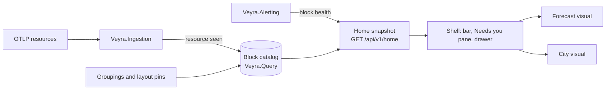

# Home dashboards

Status: design, not implemented. Decision record: [ADR 0007](../adr/0007-home-dashboards-blocks-and-groups.md).

A home dashboard is the first screen a user sees. Veyra offers several, and each user picks one. Every home draws
the same model of **blocks** and **groups**, so the same system has the same state, colour, and name on every home.



## Blocks

A block is one monitored thing. Every block has the same fields, and dashboards rely on nothing else.

| Field | Meaning |
| --- | --- |
| `id` | Stable identity derived from resource attributes. See the identity table. |
| `kind` | `service`, `host`, `container`, `k8s-node`, `database`, `queue`, `job`, `cloud-resource`, or `external`. |
| `name` | Display name, for example `payments-gateway`. |
| `environment` | From `deployment.environment.name`, or `deployment.environment` on older SDKs. |
| `signals` | Up to four, each optional: `traffic`, `errors`, `latency`, `saturation`. Each has a value, a unit, and a 4-week baseline for the current hour. |
| `health` | `ok`, `caution`, `warning`, or `unknown`, with a reason, a since time, and the IDs of the alerts that set it. |
| `headline` | The single value to show: the signal behind the worst health, otherwise traffic. |
| `weight` | Size from 1 to 8, computed on the server from traffic on a log scale relative to the environment median. Every dashboard sizes things the same way. |
| `activity` | From 0 to 1: the current signal level relative to the block's own baseline. |
| `links` | IDs of upstream and downstream blocks. They come from traces once traces exist, or from configuration. |

### Identity

Identity uses only standard OpenTelemetry semantic conventions, so applications need no Veyra-specific code.

| Kind | Identity attributes |
| --- | --- |
| service | `deployment.environment.name`, `service.namespace`, `service.name` |
| host | `host.id`, falling back to `host.name` |
| container | `container.name` within its host or pod owner. Short-lived containers roll up into their service. |
| k8s-node | `k8s.cluster.name`, `k8s.node.name` |
| database | `db.system`, `server.address`, `db.namespace` |
| queue | `messaging.system`, `messaging.destination.name` |
| job | `service.name` plus the job name from the span or log attribute the integration documents |
| cloud-resource | `cloud.resource_id` |
| external | `peer.service` or `server.address` seen only as an outbound target |

A rename creates a new block. The catalog supports aliases, so an old block can be merged into a new one and keep
its history and layout position.

### Health

- Health is set only by alert rules in `Veyra.Alerting`. A lit block always has an alert behind it, and that alert
  explains why.
- `warning` means users are affected now. `caution` means something needs attention but users are not affected
  yet.
- `unknown` means no data arrived within the expected interval for that kind. It is drawn as grey or a ghost. It
  is counted separately and never counted as healthy.
- In v0.1, only logs exist. Traffic is the log rate and errors are the error-log rate. Latency and saturation are
  absent, and dashboards must handle absent signals.

## Groupings and groups

A **grouping** is a named way to split all blocks in an environment into groups. Several groupings can exist side
by side, and each dashboard chooses which one it shows.

| Grouping | Source | Example groups |
| --- | --- | --- |
| Layer | Built in, by kind | Edge, Services, Data, Hosts, Kubernetes, Jobs |
| Team | User rules | Payments team, Platform team |
| Journey | User rules | Sign-in, Search, Checkout, Orders, Invoicing |
| Any attribute | One rule per value | `cloud.region`, `service.namespace`, `k8s.namespace.name` |

The rules for groups:

- **One group per block in a grouping.** This is what lets City draw clean districts and Forecast draw one row per
  group.
- **Rules are matched in order, and the first match wins.** A rule matches on kind or on resource attributes, using
  equals, prefix, or a glob. Manual includes and excludes override rules.
- **Nothing disappears.** A block that matches no rule lands in `Ungrouped`, which is always shown.
- **Two levels at most.** A group may contain subgroups, for example a Hosts district with a `web` subgroup. A
  third level is rejected because it no longer reads at first sight.

```json
{
  "id": "journey",
  "name": "Journey",
  "groups": [
    { "id": "checkout", "name": "Checkout", "rules": [{ "attr": "service.namespace", "eq": "checkout" }],
      "include": ["host:web-01", "host:web-02", "external:psp"],
      "subgroups": [{ "id": "checkout-web", "name": "Web tier", "rules": [{ "attr": "host.name", "glob": "web-*" }] }] },
    { "id": "orders", "name": "Orders", "rules": [{ "attr": "service.namespace", "eq": "orders" }] }
  ]
}
```

### Collapsed groups are blocks

Any group can be shown collapsed. A collapsed group obeys the full block contract, so a dashboard needs no special
case for it.

| Block field | Collapsed group value |
| --- | --- |
| `health` | The worst member state. `unknown` only if every member is unknown. |
| `headline` | The worst member and how many members are affected, for example `aks-a-2 · 1 of 4`. |
| `weight` | Computed from the summed traffic of the members. |
| `activity` | The traffic-weighted mean of the members. |
| `links` | The union of member links that leave the group. |

A group can be set to always collapse, for example identical replicas. The shell also collapses groups when a
dashboard has more items than its declared capacity, starting with the largest healthy groups. A collapsed group
that contains a lit member still shows that member's state. Selecting a collapsed group expands it in place.

### Group health beyond worst-of

Worst-of is the only rule a group applies itself. Quorum logic, such as "warning when 2 of 3 replicas are down", is
an alert rule on the group in `Veyra.Alerting`. That keeps every threshold in one place.

## The decent-citizen rules

Every dashboard must obey these rules, and contract tests check them.

1. **Draw or count every block.** If space runs out, collapse groups or show a visible "+N more". Never drop a
   block silently.
2. **Same meaning everywhere.** States, colours, and words are shared: red is warning, amber is caution, and grey
   is unknown.
3. **Data decides the look.** A block looks the way its kind, weight, health, and activity say. There is no styling
   per block inside one dashboard.
4. **Everything can be selected.** Blocks and groups can be selected with mouse and keyboard. The selection is
   shared with the shell, and selecting opens the same detail drawer on every home.
5. **Stable positions.** Nothing reshuffles between refreshes. New blocks are added to the end of their group.
6. **Light and dark themes.** Both work, with WCAG AA contrast for text and state colours.
7. **Every screen size.** The dashboard works on desktop, tablet, and phone, as described in Screen sizes.

## Screen sizes

Every home works on desktop, tablet, and phone. The shell decides the layout, so a dashboard only has to draw its
visual in the space it is given.

| Size | Width | Layout |
| --- | --- | --- |
| Desktop | 1200 px and wider | The visual and the Needs you pane side by side. |
| Tablet | 768 to 1199 px | The visual on top, the Needs you pane below. Environment pills fold into a menu. |
| Phone | Below 768 px | The Needs you list first, then the visual. The bar keeps the master lights and the menu. |

- **Forecast.** On a phone, the hero, the key metrics, the hourly strip, and the outlook stack in one column.
- **City.** On a phone, the city is a map that can be panned and zoomed. The district list in the pane footer is the
  main way to move around.
- **Touch.** Tapping selects, like a click. Touch targets are at least 44 by 44 px.

## The shell

The shell is shared by all homes and owns everything that must look the same on each of them.

- **Top bar.** It holds the environment pills with their condition and error rate, and the home choice: Forecast,
  City, and the separate Station view. It also holds master warning and master caution with their counts, and the
  clock.
- **Needs you pane.** Alerts are listed warnings first. Within each severity they are ordered by user impact, which
  means a dependency path to an entry point, and then by age. They are numbered 1 to n, and those numbers are the
  badges a dashboard draws on its visual. The selected alert shows its steps and configured actions. At most nine
  are listed, followed by "+N more".
- **Detail drawer, selection, and refresh.** The snapshot is polled every 15 seconds. Streaming updates are a later
  decision.

## The dashboard contract

```ts
interface HomeDashboard {
  id: string;                 // "forecast", "city"
  title: string;
  capacity: number;           // the most items it can draw; the shell collapses groups to fit
  defaultGrouping: string;    // "journey" if defined, otherwise "layer"
  Visual: React.FC<HomeVisualProps>;
  PaneFooter?: React.FC<HomeVisualProps>;
}

interface HomeVisualProps {
  snapshot: HomeSnapshot;     // the same object for every dashboard
  grouping: Grouping;         // the grouping the user chose for this dashboard
  selection: string | null;   // a block or group id, shared with the shell
  onSelect(id: string | null): void;
  theme: "light" | "dark";
}
```

Dashboards are compiled into the frontend and registered in a static list. Each user's choice is a user
preference, and the instance default is set in configuration. The configuration key will be documented in
`deploy/.env.example` once it is implemented.

## The snapshot

`GET /api/v1/home?environment=production` returns one object. Its target size is under 1 MB for 2,000 blocks.

```json
{
  "environment": "production",
  "at": "2026-11-07T07:34:12Z",
  "condition": { "kind": "storm", "over": "group:journey/checkout", "errorRatio": 0.058 },
  "counts": { "warning": 2, "caution": 5, "ok": 31, "unknown": 0 },
  "alerts": [{ "n": 1, "id": "alr-881", "block": "service:production/payments/payments-gateway", "severity": "warning", "summary": "Error rate 5.8%", "since": "2026-11-07T06:58:00Z", "steps": [] }],
  "blocks": [],
  "groupings": [],
  "metrics": [],
  "hourly": { "observed": [], "expected": [] },
  "outlook": []
}
```

## Forecast

The environment is read like a weather report.

| Element | Model |
| --- | --- |
| Condition | `clear` when nothing is lit, `showers` when there are cautions only, `storm` when there is any warning |
| "over Checkout" | The top-level group, in the dashboard's grouping, that holds alert 1 |
| Hero number | The environment error ratio across service blocks |
| Key metrics | A fixed set: errors, p95 latency, ingest rate, lowest free disk, backups, open incidents |
| Hourly strip | The observed error ratio for past hours, then the expected load from the 4-week baseline |
| Outlook | Dated projections for the next 30 days: error budget exhaustion, disk full, certificate expiry, storage thresholds |
| Pane footer | One row per top-level group, with one dot per block or collapsed group. Only lit dots glow. |

## City

The environment is drawn as a city. Every element of the picture has one meaning.

| City element | Model |
| --- | --- |
| District | A top-level group in the chosen grouping. Its name is drawn on the ground. |
| Street block inside a district | A subgroup |
| Building | One block, or one collapsed group |
| Building shape | Kind: tower for a service, box with roof units for a host or node, round roof for a database, long hall for a queue, warehouse for a job |
| Collapsed group | A campus on a 2 × 2 footprint with a `×4` label |
| Height | `weight`, from 1 to 8 floors |
| Lit windows | `activity`, measured against the block's own normal for this hour |
| Fire, glow, ghost | Warning, caution, unknown |
| City edge | External dependencies stand outside the city limits, beside the road that leads to them. |
| Streets between districts | Dependency links combined between groups. Moving lights show request rate once traces exist. |
| Red line | The dependency path of the selected alert, from its block to the entry point |
| Numbered badge | The alert's number in the Needs you pane |
| Pane footer | One row per district, with a bar split into fire, glow and calm, and the calm count, for example `10/12` |

The layout is deterministic and stable:

- **Districts.** Districts sit on a grid in the grouping's group order.
- **Lots.** Each district has a rectangle of lots. Members fill the lots by subgroup and then by a stable key, and a
  new block takes the next free lot.
- **Growing districts.** A district grows in fixed steps, so existing lots keep their coordinates.
- **Removed blocks.** A block that sends no data for 7 days frees its lot. Until then it shows as a ghost.
- **Pins.** A user can pin a district or a building to a position, and pins override the automatic layout.
- **Capacity.** City draws about 200 items before the shell collapses groups. Larger estates rely on collapsed
  groups, so a district of 40 identical pods is one campus, not 40 towers.

## Open questions

- Where user preferences live depends on the authentication design, which is still to come.
- Whether forecasting projections live in `Veyra.Query` or in a separate module. Decide this when the first
  projection is implemented.
- How a user edits groupings: in the UI only, or also as a file that can be checked into a repository.
