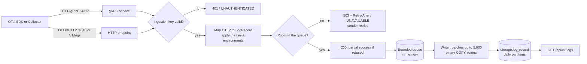

# Ingestion

How a log record travels from an application into PostgreSQL, and when it can be lost.

Status: logs work end to end. Metrics and traces follow the same path later.

## Receiving

- **Transports.** OTLP/gRPC on port 4317 and OTLP/HTTP on port 4318, as the OTLP specification defines them. The
  HTTP endpoint `/v1/logs` also answers on the main port 8080, so remote senders can reach it through Caddy with
  TLS. Caddy forwards gRPC calls to port 4317 as well. See [`docs/api/otlp.md`](../api/otlp.md).
- **Formats.** Protobuf and OTLP/JSON, optionally gzipped. Bodies are limited to 16 MB, also after decompression.
- **Keys.** Every request needs an ingestion key in `Authorization: Bearer` (ADR 0008). A key limited to some
  environments has the records for other environments refused, and the sender learns about it through OTLP partial
  success.
- **Wrong keys.** After 20 wrong keys from one address in a minute, that address gets `429` or `RESOURCE_EXHAUSTED`
  for the rest of the minute, before any database lookup.

## Mapping

`OtlpLogMapper` turns each OTLP record into one `LogRecord`:

- **Time.** The record's time, else its observed time, else the time Veyra received it.
- **Service and environment.** From the resource attributes `service.name` (default `unknown_service`) and
  `deployment.environment.name`, or the older `deployment.environment`.
- **Values.** Attribute and body values that are not strings become text; arrays and maps become JSON. The
  instrumentation scope name is kept as the attribute `otel.scope.name`.
- **IDs.** Trace and span IDs become lower-case hex; all-zero IDs mean none.

## Buffering and backpressure

- **Bounded queue.** Accepted records wait in an in-memory queue limited to `Veyra:Ingestion:MaxQueueLength` records,
  10,000 by default. A record keeps its place until it is written, not just read.
- **Backpressure.** When a request does not fit, Veyra answers `503` with `Retry-After: 1` over HTTP and `UNAVAILABLE`
  over gRPC. OTLP senders retry those with back-off, so a slow or unavailable database slows senders down instead of
  exhausting Veyra's memory.
- **Writing.** One background writer takes everything waiting, up to 5,000 records, and stores it with one binary
  `COPY`. A failed write is retried with pauses that double up to 30 seconds. The batch is never dropped while
  Veyra runs.

## When data can be lost

Veyra answers success once records are queued, before they are written. That keeps senders fast, and it means:

- **Crash or kill.** Records in the queue are lost if the process dies. At most `MaxQueueLength` records are at
  risk, usually far fewer.
- **Stop while the database is down.** On a normal stop, Veyra keeps retrying the current batch until the host stops
  it, then logs how many records it gives up.
- **Refused records.** Records refused for their environment are dropped by design, and reported to the sender.
- **Not lost: wrong clocks.** Records with a timestamp far in the past or future land in the default partition and
  are kept and searchable.

## Storage

- **Table.** `storage.log_record`, partitioned by day in UTC, with indexes for time, service, trace, word search,
  and attributes. See the migration `V0001__create_log_record.sql` in `Veyra.Storage`.
- **Partitions.** Created at startup and every hour, from yesterday to two days ahead.
- **Retention.** Every hour, daily partitions older than `LogRetentionDays` (14) are dropped, and old rows are deleted
  from the default partition. With `MaxLogStorageGigabytes` set, the oldest days are also dropped while log storage
  is over that budget, never today.
- **Search.** Newest first with keyset paging, through `ILogSearch` in `Veyra.Core`, served by
  `GET /api/v1/logs` in `Veyra.Query`.
