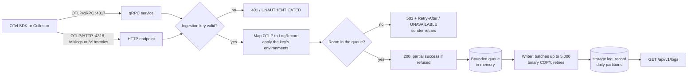
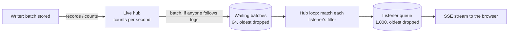

# Ingestion

How a log record or a metric point travels from an application into PostgreSQL, and when it can be lost.

Status: logs, metrics (ADR 0010), and traces (ADR 0014) work end to end.

## Receiving

- **Transports.** OTLP/gRPC on port 4317 and OTLP/HTTP on port 4318, as the OTLP specification defines them. The
  HTTP endpoints `/v1/logs` and `/v1/metrics` also answer on the main port 8080, so remote senders can reach it through Caddy with
  TLS. Caddy forwards gRPC calls to port 4317 as well. See [`docs/api/otlp.md`](../api/otlp.md).
- **Formats.** Protobuf and OTLP/JSON, optionally gzipped. Bodies are limited to 16 MB, also after decompression.
- **Keys.** Every request needs an ingestion key in `Authorization: Bearer` (ADR 0008). A key limited to some
  environments has the records for other environments refused, and the sender learns about it through OTLP partial
  success.
- **Wrong keys.** After 20 wrong keys from one address in a minute, that address gets `429` or `RESOURCE_EXHAUSTED`
  for the rest of the minute, before any database lookup.

## Mapping

`OtlpLogMapper` turns each OTLP record into one `LogRecord`:

- **Time.** The record's time, else its observed time, else the time Veyra received it.
- **Block and environment.** Each record belongs to the block its resource names (ADR 0018), by the first of:
  `service.name`; `db.system.name` with `server.address` (SQL Server's `service.instance.id` stands in for the
  address); `container.name`; `host.name`; else `unknown_service`. `TelemetryBlock.Of` in `Veyra.Core` decides it,
  for logs and metrics alike. The environment comes from `deployment.environment.name`, or the older
  `deployment.environment`. A record keeps `host.name` too.
- **Events.** A record with an OTLP `event_name`, such as a database's `db.server.query_sample`, keeps it as the
  attribute `event.name`.
- **Values.** Attribute and body values that are not strings become text; arrays and maps become JSON. The
  instrumentation scope name is kept as the attribute `otel.scope.name`.
- **IDs.** Trace and span IDs become lower-case hex; all-zero IDs mean none.

## Buffering and backpressure

- **Bounded queue.** Accepted records wait in an in-memory queue limited to `Veyra:Ingestion:MaxQueueLength` records,
  10,000 by default. A record keeps its place until it is written, not just read.
- **Backpressure.** When a request does not fit, Veyra answers `503` with `Retry-After: 1` over HTTP and `UNAVAILABLE`
  over gRPC. OTLP senders retry those with back-off, so a slow or unavailable database slows senders down instead of
  exhausting Veyra's memory.
- **Writing.** One background writer takes everything waiting, up to 5,000 records, and stores it with one binary
  `COPY`. A failed write is retried with pauses that double up to 30 seconds. The batch is never dropped while
  Veyra runs.

## Metrics

Metrics take the same path as logs, with the same keys, environment limits, and backpressure, but their own queue
and writer (ADR 0010).

- **Mapping.** `OtlpMetricMapper` turns each OTLP data point into one `MetricPoint`: gauges, sums with their
  temporality and whether they only grow, and explicit-bucket histograms with their bounds and counts. Service,
  environment, and `host.name` come from the resource, as for logs.
- **Refused.** Exponential histograms, summaries, and delta histograms are refused and reported through OTLP partial
  success, with the reason. So are points for an environment the key does not allow.
- **Queue.** `Veyra:Ingestion:MaxMetricQueueLength` points, 50,000 by default. A request that does not fit gets
  `503` or `UNAVAILABLE`, as for logs.
- **Writing.** One background writer takes up to 10,000 points, finds or creates their series, and stores the points
  with one binary `COPY`, retrying like the log writer.
- **Series limit.** Each distinct set of name and attributes is one series in `storage.metric_series`. At most
  `Veyra:Storage:MaxMetricSeries` (50,000) exist; points of new series beyond it are dropped when written, with a
  warning in Veyra's log that names the metric. Known series keep arriving.

## Traces

Traces take the same path as logs, with the same keys, environment limits, and backpressure, but their own queue and
writer (ADR 0014). Veyra stores what it receives and does not sample; sampling happens in the SDKs or the Collector
([traces integration](../integrations/traces.md)).

- **Mapping.** `OtlpSpanMapper` turns each OTLP span into one `Span`: IDs as lower-case hex, the duration to the
  microsecond, the status, and service, environment, and `host.name` from the resource.
- **Limits.** A span keeps at most 128 attributes, 128 events, and 32 links, attribute values up to 4 KB, and exception
  stack traces up to 32 KB. What is left out is counted on the span, so the trace view can say so.
- **Refused.** Spans without a trace ID, a span ID, or a start time cannot be placed in a trace and are reported
  through OTLP partial success; so are spans for an environment the key does not allow.
- **Queue.** `Veyra:Ingestion:MaxSpanQueueLength` spans, 50,000 by default, a few seconds of a busy service. A request
  that does not fit gets `503` or `UNAVAILABLE`, as for logs.
- **Writing.** One background writer takes up to 5,000 spans and stores them with one binary `COPY`, retrying like the
  log writer. A batch is written as it arrives; nothing waits for the rest of a trace.

## Live streams

Once a batch is stored, its writer hands it to `ILiveTelemetry` in `Veyra.Core` (ADR 0022). The Query module's hub
implements it and serves `GET /api/v1/live` and `GET /api/v1/logs/stream` from it
([REST API](../api/rest.md#live-get-apiv1live-and-get-apiv1logsstream)).

- **After the write.** Only stored batches are handed over, so a retried batch is never shown twice. Logs hand over
  their records; spans and metric points only their count per environment, for the rates.
- **Never in the way.** The writer's call only counts and queues; it never waits for a listener. Matching against the
  listeners runs on the hub's own loop. A failure in the hand-off is logged and the batch stays written.
- **Bounded.** At most 64 batches wait for the hub's loop, and at most 1,000 records wait for each listener. When
  either is full, the oldest goes; the listeners it would have reached get a `skipped` event with how many. Without
  anyone following logs, records are only counted.
- **Listeners.** At most `Veyra:Query:LiveListeners` streams (50) are open on one instance, set on the Settings
  screen. One more is answered `503`.
- **Rates.** Each signal is counted per environment and second, over the last ten whole seconds. Points that the
  series limit later drops are counted too: the rate says what arrives.
- **Lost for Live only.** Records a listener skipped are still stored and searchable; Live shows that it skipped them.

## When data can be lost

Veyra answers success once records are queued, before they are written. That keeps senders fast, and it means:

- **Crash or kill.** Records in the queue are lost if the process dies. At most `MaxQueueLength` records are at
  risk, usually far fewer.
- **Stop while the database is down.** On a normal stop, Veyra keeps retrying the current batch until the host stops
  it, then logs how many records it gives up.
- **Refused records.** Records and points refused for their environment, and metric points of a kind Veyra does not
  store, are dropped by design, and reported to the sender.
- **Too many series.** Points of new series beyond the series limit are dropped and logged, but not reported to the
  sender, which got its answer when they were queued.
- **Not lost: wrong clocks.** Records with a timestamp far in the past or future land in the default partition and
  are kept and searchable.

## Storage

- **Table.** `storage.log_record`, partitioned by day in UTC, with indexes for time, service, trace, words by hour,
  and attributes. See the migrations `V0001__create_log_record.sql` and `V0005__index_words_by_hour.sql` in
  `Veyra.Storage`.
- **Words by hour (ADR 0016).** Each word of a body is indexed with the UTC hour of its record, as
  `storage.log_terms(body, timestamp)` builds it, for example `deadlock@498452`. A word search walks the hours of its
  window newest first, looking up only each hour's keys, and stops when the page is full, so it takes the same time
  however long ago a word last appeared. Word counts look the words up in every hour of the window.
- **Partitions.** Created at startup and every hour, from yesterday to two days ahead.
- **Retention.** Every hour, daily partitions older than `LogRetentionDays` (14) are dropped, and old rows are deleted
  from the default partition. With `MaxLogStorageGigabytes` set, the oldest days are also dropped while log storage
  is over that budget, never today.
- **Blocks (ADR 0018).** A log record's `service_name` holds the name of its block and `block_kind` its kind (1
  service, 2 host, 3 database, 4 container), so a database server's events are found through the same name and time
  index as a service's records. The per-minute and per-hour counts keep the kind too: error rates and the home count
  services only. Metric series have `block_kind` and `block_name` with an index of their own, which a database
  screen reads. Records and series stored before the migration `V0007__telemetry_blocks.sql` count as their service,
  or for host metrics their host.
- **Metrics.** `storage.metric_series` holds each series once; `storage.metric_point` holds the points in daily
  partitions, created and dropped like the log partitions, after `MetricRetentionDays` (30). Series without points
  for that long are deleted. See the migration `V0002__create_metrics.sql`. Rates of counters and percentiles of
  histograms are computed when read, in `Veyra.Query`.
- **Search.** Newest first with keyset paging, through `ILogSearch` in `Veyra.Core`, served by
  `GET /api/v1/logs` in `Veyra.Query`.
- **Spans (ADR 0014).** `storage.span` holds one row per span, partitioned by day on its start, with IDs as bytes. Its
  indexes find a trace's spans, a service's spans in a window, failed spans, and attributes; two partial indexes on
  root spans hold every column the trace list shows, so the list is read from them alone. Traces keep
  `TraceRetentionDays` (7), with an optional budget, `MaxTraceStorageGigabytes`, dropped by whole days like logs. See
  the migration `V0006__create_spans.sql`.
- **Trace reads.** Through `ITraceSearch` in `Veyra.Core`. The list pages by start time and span ID, and counts each
  listed trace's spans, failures, and services for that page only; the duration chart reads at most the newest 20,000
  traces; a trace opened with a known time reads its day and the days next to it first.
- **Log counts (ADR 0015).** `storage.log_count_minute` and `storage.log_count_hour` hold the number of records per
  minute and hour, by environment, service, and severity, in daily partitions dropped with the records. The writer adds
  each batch's counts in the same transaction as its `COPY`, so they are exact and current. The histogram, the home,
  and the error-rate rules read them; only the seconds at the edges of a window, and filters the counts do not hold
  (words, attributes, a trace), read the records. A word or an attribute is counted with 64 MB of work memory and
  four parallel workers, set for that one transaction, because a common one is on nearly every page of a day. See
  `V0003__create_log_counts.sql`.
- **Ingest counts (ADR 0023).** `storage.ingest_count_minute` holds, per minute, environment, and signal (`logs`,
  `spans`, `points`), how many were stored. The log, span, and metric writers each add their batch's counts in the
  same transaction as the batch, with one `INSERT … ON CONFLICT DO UPDATE` on the batch's few keys, so the counts are
  exact and current, and a batch that fails adds nothing. A record counts in the minute of its timestamp, a span in
  that of its start, a point in that of its time; metric points the series limit drops are not counted. The Overview
  reads them through `IIngestCounts` in `Veyra.Core`, adding the minutes up per step, hours included. The table has
  daily partitions, created with the others and dropped after 30 days, the longest range a screen offers, whatever
  the retention of the signals. Counting starts with the migration `V0010__create_ingest_counts.sql`; telemetry stored
  before it is not counted.
- **Job runs (ADR 0027).** `storage.job_run` holds one row per run of a job: its source (`trace` or `sqlagent`),
  block, environment, name, run ID, start, duration, status, steps, records, retries, trace, and message. The span
  writer adds a run for each root span of the batch that carries one of `Jobs:NameAttributes`, in the transaction of
  the batch's `COPY`, after the copy, so its steps (the root's direct children, at most 100) are read from the spans
  already stored and those of the batch; the steps are kept with the run, because the spans go after 7 days. The
  activity writer adds a SQL Server Agent run for each job history row of step 0, in the batch that stores the row;
  its steps stay in `storage.db_record` and are read from there. A unique index on the job and the run makes a resent
  span or row an update, and lists a job's runs newest first; a second index on the start serves windows of every job,
  added up per job in the database. Daily partitions, created at startup and every hour, are dropped after
  `JobRunRetentionDays` (30). Read through `IJobRuns` in `Veyra.Core`. See `V0012__create_job_runs.sql`; runs that
  arrived before it are not in the table.
- **Metric rollups (ADR 0015).** `storage.metric_rollup_5m` and `storage.metric_rollup_1h` hold one row per series
  and 5 minutes or hour: the number of points, the sum of their values, and the last point as stored. A background job
  rolls up every finished 5 minutes once it is 2 minutes old, and every finished hour; reads take the newest minutes
  from the points, so charts stay current. A point that arrives for a time already rolled up marks its hour in
  `storage.metric_rollup_dirty`; the hour is read from the points until the job rolls it up again, so late points
  are never missing. A read uses a rollup when each of its rows falls into one bucket: buckets that are whole
  multiples of it, or one bucket over the whole read, such as a statement's total over a range ending now (VEY-65),
  starting on its boundary. See `V0004__create_metric_rollups.sql`.
- **Metric windows (ADR 0022).** Every metrics endpoint takes `from` and `to`, or a `range` ending now, up to 31 days.
  `Veyra.Query` chooses the step: whole minutes up to six hours, read from the points and the 5-minute rollups, and
  whole hours beyond, read from the hourly rollups. Buckets start on multiples of their width, so every rollup row
  falls into one bucket, and the step keeps a line at most 180 points (72 for overview cards and resource lists).
- **Inventory (ADR 0022).** `IMetricSearch.ListBlocksAsync` lists every block that has series kept, grouped through the
  `metric_series_block` index: per environment, and per host for a container, with the hosts its series name, its
  instances, its newest resource attributes, and when it was last seen. Retention deletes series it no longer keeps
  points for, so this is everything Veyra knows. The Resources lists read it, so a host that stopped stays listed as
  silent until its metrics age out.
- **Upgrading.** Records and points written before counts and rollups existed are listed in
  `storage.log_count_backfill` and `storage.metric_rollup_backfill`. A background job counts and rolls them up a day
  at a time, newest first; until a day is done, it is read from its records and points, so nothing is wrong meanwhile,
  only slower. Days written before the index of words by hour are listed in `storage.log_terms_backfill`; the same job
  builds it on each with `CREATE INDEX CONCURRENTLY`, newest first, so ingestion never waits, and a day not yet done
  is searched and counted the old way. When none is left, the job drops the old word index.
- **Speed.** Every request has a budget (ADR 0015), checked by the benchmark in `scripts/benchmark` and by plan
  tests that fail when a query stops reading its counts, rollups, or partitions.
