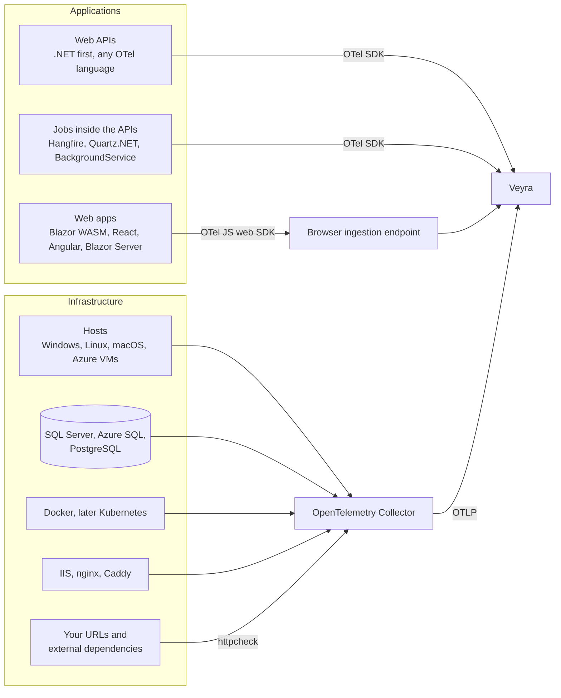

# Monitoring scope

Status: agreed scope, not implemented. Milestones follow the roadmap in [`README.md`](../../README.md).

This page lists what Veyra monitors, how the data reaches it, and what a user sees. Everything arrives over OTLP,
either from the standard OpenTelemetry SDK inside an application or from the OpenTelemetry Collector running next
to a host, database, or cloud account. Veyra has no SDK and no agent of its own.

## Targets

### Web APIs

- **How.** The OpenTelemetry .NET SDK with the OTLP exporter. Logs come from `ILogger`, metrics and traces from the
  ASP.NET Core, HttpClient, SqlClient, Entity Framework Core, and runtime instrumentation.
- **What you see.** Logs first, then request rate, error rate, and latency, then traces across services.
- **Other languages.** OTLP is language neutral, so services in Node.js, Java, Python, Go, or any other language with
  an OpenTelemetry SDK work without changes in Veyra. .NET is tested and documented first. Guides for other
  languages are added when someone needs them.

### Jobs inside the APIs

- **How.** The same SDK. Supported first: Hangfire, Quartz.NET, and `BackgroundService`. Hangfire and Quartz.NET have
  OpenTelemetry instrumentation packages. `BackgroundService` needs a small documented pattern that starts one span
  per run. More libraries can follow.
- **What you see.** Every run with its duration and outcome, the last successful run, failures, and missed runs.
- **Open.** Missed-run detection needs the expected schedule and a shared attribute for the job name. Both are
  settled in a separate ADR before jobs are built.

### SQL Server and PostgreSQL

- **How.** The Collector `sqlserver` and `postgresql` receivers, plus `sqlquery` for checks that the receivers do
  not cover. Azure SQL is also read through `azuremonitor`.
- **Supported versions.** Versions released in the last six years that the vendor still supports:
  - SQL Server 2019, 2022, and 2025, on premises and on VMs. SQL Server 2019 is slightly older than six years and
    is included because Microsoft supports it until 2030.
  - Azure SQL Database and Azure SQL Managed Instance.
  - PostgreSQL 14 and newer.
- **What you see.** Connections, waits, deadlocks, blocking, long-running queries, database and log size growth,
  backup age, failed SQL Agent jobs on SQL Server, and vacuum and transaction ID wraparound on PostgreSQL.

### Operating systems

- **How.** The Collector on each host with `hostmetrics`. Windows adds `windowsperfcounters` and `windowseventlog`.
  Linux adds `journald` and `filelog`. macOS uses `hostmetrics` only. Azure VMs use the same Collector setup as any
  other Windows or Linux host.
- **What you see.**
  - CPU, memory, swap, disk space, disk throughput and latency, network throughput and errors, uptime, and reboots.
  - Processes: the top consumers of CPU and memory, runaway processes, crash and restart loops, and expected
    services or processes that are missing. Per-process data is limited to selected or top processes to keep the
    volume down.
  - Issues: errors and critical events from the Windows Event Log, failed systemd units, out-of-memory kills, disk
    errors, unexpected shutdowns, and clock skew, which Veyra detects by comparing record timestamps with arrival
    time.
- **Later.** A process that has never run on a host before can be flagged against that host's history. This is a
  hint for a person to look at, not malware detection.

### Web apps

- **Order.** Blazor WebAssembly first, then React, then Angular, then Blazor Server.
- **How.**
  - React, Angular, and Blazor WebAssembly load the OpenTelemetry JavaScript web SDK. .NET in the browser has no
    mature OpenTelemetry exporter, so a Blazor WebAssembly app loads the JavaScript SDK next to Blazor.
  - Blazor Server runs on the server, so it uses the .NET SDK, plus circuit metrics.
- **What you see.** Page loads, Core Web Vitals, JavaScript errors, and slow API calls, linked to the backend trace
  through the `traceparent` header.
- **Needs an ADR first.** Browsers send to a public endpoint. That endpoint needs write-only keys per app, allowed
  origins, rate and size limits, and removal of personal data before storage.

### Further targets

- **Containers.** Docker through `docker_stats` and container logs. Kubernetes later.
- **Web servers and reverse proxies.** IIS, nginx, and Caddy, through their access logs and metrics.
- **Uptime and certificate checks.** `httpcheck` probes your own URLs and external dependencies, such as a payment
  provider, and reports days until each TLS certificate expires.
- **Release markers.** A change of `service.version` is recorded as a release, so a view can say "since release
  2.14.1".
- **Message queues.** RabbitMQ and Azure Service Bus, later.
- **Azure platform services.** App Service, Azure SQL, and storage accounts through `azuremonitor`, later.
- **Veyra itself.** Veyra reports its own ingestion queue, dropped records, storage size, and free disk, and the
  reference installation monitors the host it runs on.

## Out of scope

- Continuous profiling.
- Session replay.
- Security analytics and SIEM features.

## Where data is kept

All retention applies to Veyra's own storage. Monitored hosts keep nothing for Veyra. The Collector holds data on a
host only while Veyra is unreachable, in a bounded queue that each integration configuration documents.

- **Per signal.** Retention is configured per signal. Logs keep 14 days by default (`Veyra:Storage:LogRetentionDays`),
  metrics 30 days (`Veyra:Storage:MetricRetentionDays`, ADR 0010). The proposed default for traces is 7 days.
- **Sign-in history.** Sign-in attempts and ended sessions, with addresses, keep 90 days
  (`Veyra:Access:SignInHistoryDays`, ADR 0011).
- **Series limit.** Metrics are also bounded by `Veyra:Storage:MaxMetricSeries` (50,000), so one attribute with
  too many values cannot fill the disk.
- **Partitions.** Old data is removed by dropping whole daily partitions, which is instant and frees disk at once.
- **Disk guard.** Veyra cannot see free space on the database host, so the guard is a size budget instead
  (`Veyra:Storage:MaxLogStorageGigabytes`). When log storage exceeds it, the oldest days are dropped first and a
  warning is logged; today is always kept. Raising an alert for it follows with the Alerting module.
- **Sizing.** Expected volume is not known yet. The defaults are validated against real numbers from the reference
  installation, and a sizing guide follows.
