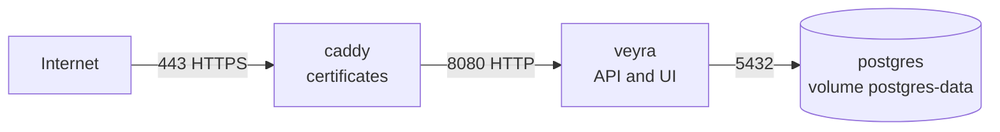

# Deployment

How to run Veyra on a Linux server with Docker Compose, behind Caddy with automatic HTTPS.

Status: Veyra receives logs over OTLP, stores them in PostgreSQL, and shows them on the home and in the Log Explorer.
It has accounts, roles, and ingestion keys (ADR 0008), and sends alerts to webhook and email channels.



## What you need

- A Linux server with Docker Engine and the Docker Compose plugin.
- A DNS record (A, and AAAA for IPv6) that points your Veyra host name at the server.
- Ports 80 and 443 open to the internet, for HTTPS and for the certificate challenge. Port 22 open to you, for SSH.
  On Hetzner Cloud, set this in the server's firewall as well as on the host.

## First installation

1. Get the code on the server.

   ```bash
   git clone https://github.com/civauva/Veyra.git
   cd Veyra
   ```

2. Create the settings file from the example and fill it in.

   ```bash
   cp deploy/.env.example deploy/.env
   ```

   - `POSTGRES_PASSWORD`: generate one with `openssl rand -hex 32`.
   - `VEYRA_DOMAIN`: your host name, for example `veyra.example.com`.

   `deploy/.env` holds secrets. Git ignores it. Keep it readable only by you: `chmod 600 deploy/.env`.

3. Build and start Veyra, PostgreSQL, and Caddy.

   ```bash
   docker compose -f deploy/docker-compose.yml -f deploy/docker-compose.caddy.yml up -d --build
   ```

4. Check that it works. Caddy needs a few seconds for the first certificate.

   ```bash
   curl https://veyra.example.com/healthz
   curl https://veyra.example.com/readyz
   ```

   Both answer `200`. `/healthz` means the process is up. `/readyz` means Veyra can also reach PostgreSQL.

5. Create the first administrator. On its first start, Veyra writes a one-time setup link to its log:

   ```bash
   docker compose -f deploy/docker-compose.yml logs veyra | grep "First-run setup"
   ```

   The link contains a token, valid for 24 hours and for one use. Replace `<your host>` with your domain, open the
   link in a browser, and choose the administrator's email, name, and password. Then sign in.

   A restart before setup issues a new link, and the old one stops working.

## Sending telemetry

Create an ingestion key on the **Keys** page (administrators only; the secret is shown once), then point the
OpenTelemetry SDK or Collector at
`https://<your host>`. Senders on the server itself can use `127.0.0.1:4317` (gRPC) or `127.0.0.1:4318` (HTTP). See
[`docs/api/otlp.md`](../api/otlp.md), for .NET [`docs/integrations/dotnet.md`](../integrations/dotnet.md), and for
the host's own CPU, memory, and disks [`docs/integrations/linux.md`](../integrations/linux.md).

## Alert notifications

Veyra raises an alert when a service logs too many errors and can tell people about it. Administrators add
webhook and email channels on the **Notifications** page and send a test message from there.

- Set `VEYRA_PUBLIC_URL` to the public address, for example `https://veyra.example.com`, so messages link to the
  alert.
- For email, set `VEYRA_SMTP_HOST`, `VEYRA_SMTP_FROM`, and if the server needs it `VEYRA_SMTP_USERNAME` and
  `VEYRA_SMTP_PASSWORD`. The port defaults to 587 with STARTTLS. Webhooks need no settings.

Stored webhook URLs are encrypted with the keys in the `veyra-keys` volume; see [Backups](#backups) and
[ADR 0009](../adr/0009-alert-notifications.md). How
notifications behave, and the JSON a webhook receives, are in
[`docs/architecture/alerting.md`](../architecture/alerting.md#notifications).

## Upgrading

```bash
git pull
docker compose -f deploy/docker-compose.yml -f deploy/docker-compose.caddy.yml up -d --build
```

Veyra applies new database migrations when it starts, before it accepts requests. All pending migrations run in one
transaction: if one fails, nothing changes, Veyra does not start, and its log names the failing script. Take a backup
before upgrading.

The upgrade that adds two-factor sign-in and session records (ADR 0011) signs everyone out once: sessions from before
it carry no session ID and are refused, so people sign in again.

## Backups

The data lives in the `postgres-data` volume. A logical backup:

```bash
docker compose -f deploy/docker-compose.yml exec -T postgres pg_dump --username=veyra --format=custom veyra > veyra.dump
```

Copy backups off the server. Restoring uses `pg_restore` into an empty database.

The `veyra-keys` volume holds the keys that encrypt session cookies, stored webhook URLs, and the secrets of second
factors. Losing it signs everyone out, every webhook channel needs its URL entered again, and everyone with a second
factor sets it up again (an Admin removes the old ones); it holds no telemetry. Back it up with the database.

## Troubleshooting

- **Logs.** `docker compose -f deploy/docker-compose.yml logs -f veyra` shows Veyra's log, including each migration
  it applies.
- **`/readyz` answers `503`.** Veyra runs but cannot reach PostgreSQL. Check `docker compose ps` and the `postgres`
  log.
- **No certificate.** Caddy's log (`logs caddy`) explains why. Usually the DNS record does not point at the server
  yet, or port 80 is blocked.
- **Local access without Caddy.** Veyra also listens on `127.0.0.1:8080` on the server itself, for example for
  `curl http://127.0.0.1:8080/readyz`. Set `VEYRA_HTTP_PORT` if port 8080 is taken. Signing in needs HTTPS, so
  use the public address through Caddy for anything beyond health checks. Over plain HTTP the sign-in screen says
  so.

### An Admin lost phone and recovery codes

If another Admin can sign in, they remove the second factor on the **Users** screen. If it is the only Admin:

1. Set `VEYRA_REMOVE_SECOND_FACTOR` in `deploy/.env` to that Admin's email and restart Veyra. It logs a critical
   security entry when it removes the factor.
2. Sign in with the password alone and set up a new second factor on the **Account** page.
3. Empty `VEYRA_REMOVE_SECOND_FACTOR` again and restart.

Only someone who can change the server's settings can do this, and that person already has full access.

## Personal data

Veyra keeps, per account: email, name, team, role, when it was added, and its changes with who made them. For
sign-in attempts and sessions it also keeps the IP address and the browser's description, for
`VEYRA_SIGN_IN_HISTORY_DAYS` (90 by default); attempts for emails without an account are not stored. Only Admins and
the person see this. Telemetry can carry personal data too; what your applications send is up to them.

## Configuration reference

| Variable | Used by | Meaning |
| --- | --- | --- |
| `POSTGRES_PASSWORD` | postgres, veyra | Password of the `veyra` database user. Letters and digits only. |
| `VEYRA_DOMAIN` | caddy | Public host name. Caddy obtains its certificate. |
| `VEYRA_HTTP_PORT` | veyra | Port on `127.0.0.1` for local access without Caddy. Default `8080`. |
| `VEYRA_OTLP_GRPC_PORT` | veyra | Port on `127.0.0.1` for OTLP/gRPC from this machine. Default `4317`. |
| `VEYRA_OTLP_HTTP_PORT` | veyra | Port on `127.0.0.1` for OTLP/HTTP from this machine. Default `4318`. |
| `VEYRA_LOG_RETENTION_DAYS` | veyra | Days of logs to keep. Default `14`. |
| `VEYRA_MAX_LOG_STORAGE_GB` | veyra | Size budget for log storage; the oldest days go first. Empty: none. |
| `VEYRA_METRIC_RETENTION_DAYS` | veyra | Days of metric points to keep. Default `30`. |
| `VEYRA_SIGN_IN_HISTORY_DAYS` | veyra | Days of sign-in attempts and ended sessions to keep. Default `90`. |
| `VEYRA_REMOVE_SECOND_FACTOR` | veyra | Empty. Only for the lost-phone case above. |
| `VEYRA_MAX_METRIC_SERIES` | veyra | Most metric series accepted; points of new series beyond it are dropped. Default `50000`. |
| `VEYRA_PUBLIC_URL` | veyra | Public address, for links in alert notifications. Empty: messages carry no link. |
| `VEYRA_SMTP_HOST` | veyra | SMTP server for email channels. Empty: email channels cannot send. |
| `VEYRA_SMTP_PORT` | veyra | Its port. Default `587`. |
| `VEYRA_SMTP_SECURITY` | veyra | `Auto` (default), `StartTls`, `SslOnConnect`, or `None`. |
| `VEYRA_SMTP_USERNAME`, `VEYRA_SMTP_PASSWORD` | veyra | Sign-in for the SMTP server, if it needs one. The password is a secret. |
| `VEYRA_SMTP_FROM` | veyra | Sender address, for example `Veyra <veyra@example.com>`. Required with a host. |
| `Veyra__Storage__ConnectionString` | veyra | Set by the Compose file. Override it for another PostgreSQL server. |

The built-in error-rate alert rule works without configuration: a caution from 1 % errors, a warning from 5 %, over
five minutes per service. Its settings, and those of notifications, are in
[`docs/architecture/alerting.md`](../architecture/alerting.md#configuration).
