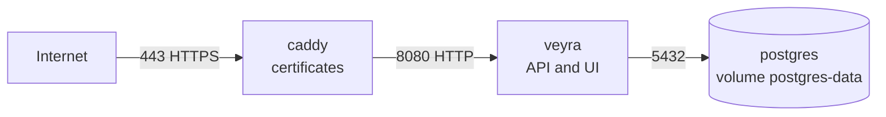

# Deployment

How to run Veyra on a Linux server with Docker Compose, behind Caddy with automatic HTTPS.

Status: Veyra receives logs over OTLP, stores them in PostgreSQL, and shows them on the home and in the Log Explorer.
It has accounts, roles, and ingestion keys (ADR 0008), and sends alerts to webhook and email channels.



## What you need

- A Linux server with Docker Engine and the Docker Compose plugin.
- A DNS record (A, and AAAA for IPv6) that points your Veyra host name at the server.
- Ports 80 and 443 open to the internet, for HTTPS and for the certificate challenge. Port 22 open to you, for SSH.
  On Hetzner Cloud, set this in the server's firewall as well as on the host.

## First installation

1. Get the code on the server.

   ```bash
   git clone https://github.com/civauva/Veyra.git
   cd Veyra
   ```

2. Create the settings file from the example and fill it in.

   ```bash
   cp deploy/.env.example deploy/.env
   ```

   - `POSTGRES_PASSWORD`: generate one with `openssl rand -hex 32`.
   - `VEYRA_DOMAIN`: your host name, for example `veyra.example.com`.
   - `POSTGRES_SHARED_BUFFERS`: about a quarter of the server's memory, for example `2GB` on an 8 GB server. The
     default, `128MB`, suits a small server; a larger cache answers word and attribute counts about twice as fast.

   `deploy/.env` holds secrets. Git ignores it. Keep it readable only by you: `chmod 600 deploy/.env`.

3. Build and start Veyra, its built-in agent, PostgreSQL, and Caddy.

   ```bash
   docker compose -f deploy/docker-compose.yml -f deploy/docker-compose.caddy.yml up -d --build
   ```

4. Check that it works. Caddy needs a few seconds for the first certificate.

   ```bash
   curl https://veyra.example.com/healthz
   curl https://veyra.example.com/readyz
   ```

   Both answer `200`. `/healthz` means the process is up. `/readyz` means Veyra can also reach PostgreSQL.

5. Create the first administrator. On its first start, Veyra writes a one-time setup link to its log:

   ```bash
   docker compose -f deploy/docker-compose.yml logs veyra | grep "First-run setup"
   ```

   The link contains a token, valid for 24 hours and for one use. Replace `<your host>` with your domain, open the
   link in a browser, and choose the administrator's email, name, and password. Then sign in.

   A restart before setup issues a new link, and the old one stops working.

## Sending telemetry

Create an ingestion key on the **Keys** page (administrators only; the secret is shown once), then point the
OpenTelemetry SDK or Collector at
`https://<your host>`. Senders on the server itself can use `127.0.0.1:4317` (gRPC) or `127.0.0.1:4318` (HTTP). See
[`docs/api/otlp.md`](../api/otlp.md), for .NET [`docs/integrations/dotnet.md`](../integrations/dotnet.md), and for
the host's own CPU, memory, and disks [`docs/integrations/linux.md`](../integrations/linux.md).

SQL Servers need none of this: add them on **Settings → Database monitoring**. Veyra's built-in agent, the `agent`
container beside Veyra, reads every server Veyra's host can reach. It sets itself up on Veyra's first start; its key
and start-up file live in the `agent-config` volume, and **Settings → Agents** shows whether it runs. See
[`docs/integrations/sqlserver.md`](../integrations/sqlserver.md#from-the-settings-screen).

## Settings

Admins change Veyra's settings on the **Settings** screen: retention and size budgets, the alert rules, the email
server, sign-in and lockout, queue lengths, and a few advanced ones. A change applies at once, without a restart
([ADR 0017](../adr/0017-settings-in-the-admin-ui.md)).

- **Simple and Advanced.** The Simple view shows the basics: retention, each rule's switch and levels, the email
  server, and sign-in. Advanced adds the rest, such as how rules measure and clear and the queue lengths. The search
  finds every setting in either view. Metrics, Logs, Traces, and Alerts have the same toggle, and the choice holds
  across them: Simple shows the fundamentals, Advanced everything.
- **First values.** `deploy/.env` gives the first values. A value saved on the screen wins; **Reset** goes back to
  the value from `deploy/.env`, or to Veyra's default when the file sets none. The screen says where each default
  comes from.
- **Review.** Saving shows what each change will do. A change that deletes data, such as a shorter retention, says how
  much, and needs a confirmation.
- **History.** Every change is kept for a year with who saved it, and can be reverted from the history.
- **Export and import.** The saved values can be exported as a JSON file and imported on another installation, with
  the same review. Secrets are never in the file.
- **Secrets.** The SMTP password set on the screen is stored encrypted with the keys in the `veyra-keys` volume and
  is never shown again. Back up that volume with the database (see [Backups](#backups)).
- **Outside the screen.** The database connection, the ports, and `VEYRA_REMOVE_SECOND_FACTOR` stay in
  `deploy/.env`, because they are needed before the database can be read or when nobody can sign in. The screen's
  System section shows them read-only.

## Alert notifications

Veyra raises an alert when a service logs too many errors and can tell people about it. Administrators add
webhook and email channels on the **Notifications** page and send a test message from there.

- Set Veyra's public address, for example `https://veyra.example.com`, so messages link to the alert: on the
  Settings screen, or as `VEYRA_PUBLIC_URL`.
- For email, set the server and the sender on the Settings screen, under Notifications and email, or as
  `VEYRA_SMTP_HOST` and `VEYRA_SMTP_FROM` with `VEYRA_SMTP_USERNAME` and `VEYRA_SMTP_PASSWORD` if the server needs
  them. The port defaults to 587 with STARTTLS. Webhooks need no settings.

Stored webhook URLs are encrypted with the keys in the `veyra-keys` volume; see [Backups](#backups) and
[ADR 0009](../adr/0009-alert-notifications.md). How
notifications behave, and the JSON a webhook receives, are in
[`docs/architecture/alerting.md`](../architecture/alerting.md#notifications).

## Upgrading

```bash
git pull
docker compose -f deploy/docker-compose.yml -f deploy/docker-compose.caddy.yml up -d --build
```

Veyra applies new database migrations when it starts, before it accepts requests. All pending migrations run in one
transaction: if one fails, nothing changes, Veyra does not start, and its log names the failing script. Take a backup
before upgrading.

The upgrade that adds two-factor sign-in and session records (ADR 0011) signs everyone out once: sessions from before
it carry no session ID and are refused, so people sign in again.

### From your machine to a server with a shared proxy

A server that runs other apps often has one proxy, such as Caddy, that owns ports 80 and 443 for all of them and
reaches each app over a Docker network named `edge`. `scripts/deploy.sh` deploys there over SSH, without building
on the server:

```bash
DEPLOY_HOST=my-server bash scripts/deploy.sh [branch-or-tag]
```

- `DEPLOY_HOST` is an SSH host or alias that signs in without a prompt, as a user in the server's `docker` group.
- The script builds the Veyra and agent images from a clean checkout of the ref (`main` by default), copies them to
  the server, and starts them with `deploy/docker-compose.edge.yml`. That file publishes no ports, puts the Veyra
  container on `edge` as `veyra-web`, and limits every container's memory.
- It writes the proxy's site file, `/opt/edge/sites/veyra.caddy` (`EDGE_SITES` changes the folder), validates the
  proxy's configuration, reloads it, and waits until the site answers over HTTPS. Once, as root on the server:
  `touch /opt/edge/sites/veyra.caddy`, then `chown <user> /opt/edge/sites/veyra.caddy`.
- The server's `.env` lives in `/opt/veyra` (`DEPLOY_DIR`) and never leaves it. On the first run the script puts
  `deploy/.env.example` there and stops; fill it in on the server and run the script again.

On a small server keep `POSTGRES_SHARED_BUFFERS` low, such as `128MB`.

## Backups

The data lives in the `postgres-data` volume. A logical backup:

```bash
docker compose -f deploy/docker-compose.yml exec -T postgres pg_dump --username=veyra --format=custom veyra > veyra.dump
```

Copy backups off the server. Restoring uses `pg_restore` into an empty database.

The `veyra-keys` volume holds the keys that encrypt session cookies, stored webhook URLs, and the secrets of second
factors. Losing it signs everyone out, every webhook channel needs its URL entered again, and everyone with a second
factor sets it up again (an Admin removes the old ones); it holds no telemetry. Back it up with the database.

## Troubleshooting

- **Logs.** `docker compose -f deploy/docker-compose.yml logs -f veyra` shows Veyra's log, including each migration
  it applies.
- **`/readyz` answers `503`.** Veyra runs but cannot reach PostgreSQL. Check `docker compose ps` and the `postgres`
  log.
- **No certificate.** Caddy's log (`logs caddy`) explains why. Usually the DNS record does not point at the server
  yet, or port 80 is blocked.
- **Local access without Caddy.** Veyra also listens on `127.0.0.1:8080` on the server itself, for example for
  `curl http://127.0.0.1:8080/readyz`. Set `VEYRA_HTTP_PORT` if port 8080 is taken. Signing in needs HTTPS, so
  use the public address through Caddy for anything beyond health checks. Over plain HTTP the sign-in screen says
  so.

### An Admin lost phone and recovery codes

If another Admin can sign in, they remove the second factor on the **Users** screen. If it is the only Admin:

1. Set `VEYRA_REMOVE_SECOND_FACTOR` in `deploy/.env` to that Admin's email and restart Veyra. It logs a critical
   security entry when it removes the factor.
2. Sign in with the password alone and set up a new second factor on the **Account** page.
3. Empty `VEYRA_REMOVE_SECOND_FACTOR` again and restart.

Only someone who can change the server's settings can do this, and that person already has full access.

## Personal data

Veyra keeps, per account: email, name, team, role, when it was added, and its changes with who made them. For
sign-in attempts and sessions it also keeps the IP address and the browser's description, for
`VEYRA_SIGN_IN_HISTORY_DAYS` (90 by default); attempts for emails without an account are not stored. Only Admins and
the person see this. Telemetry can carry personal data too; what your applications send is up to them.

## Configuration reference

The variables marked *first value* can be changed later on the Settings screen, where a saved value wins.

| Variable | Used by | Meaning |
| --- | --- | --- |
| `POSTGRES_PASSWORD` | postgres, veyra | Password of the `veyra` database user. Letters and digits only. |
| `POSTGRES_SHARED_BUFFERS` | postgres | PostgreSQL's page cache. Default `128MB`; a quarter of the memory is faster. |
| `VEYRA_DOMAIN` | caddy | Public host name. Caddy obtains its certificate. |
| `VEYRA_HTTP_PORT` | veyra | Port on `127.0.0.1` for local access without Caddy. Default `8080`. |
| `VEYRA_OTLP_GRPC_PORT` | veyra | Port on `127.0.0.1` for OTLP/gRPC from this machine. Default `4317`. |
| `VEYRA_OTLP_HTTP_PORT` | veyra | Port on `127.0.0.1` for OTLP/HTTP from this machine. Default `4318`. |
| `VEYRA_LOG_RETENTION_DAYS` | veyra | *First value.* Days of logs to keep. Default `14`. |
| `VEYRA_MAX_LOG_STORAGE_GB` | veyra | *First value.* Size budget for log storage; the oldest days go first. |
| `VEYRA_METRIC_RETENTION_DAYS` | veyra | *First value.* Days of metric points to keep. Default `30`. |
| `VEYRA_TRACE_RETENTION_DAYS` | veyra | *First value.* Days of traces to keep. Default `7`. |
| `VEYRA_MAX_TRACE_STORAGE_GB` | veyra | *First value.* Size budget for trace storage; the oldest days go first. |
| `VEYRA_DATABASE_RECORD_RETENTION_DAYS` | veyra | *First value.* Days of database plans, deadlocks, events, and setting snapshots to keep. Default `90`. |
| `VEYRA_DATABASE_SESSION_RETENTION_DAYS` | veyra | *First value.* Days of database servers' live sessions to keep. Default `7`. |
| `VEYRA_SIGN_IN_HISTORY_DAYS` | veyra | *First value.* Days of sign-in attempts and ended sessions to keep. |
| `VEYRA_REMOVE_SECOND_FACTOR` | veyra | Empty. Only for the lost-phone case above. |
| `VEYRA_MAX_METRIC_SERIES` | veyra | *First value.* Most metric series accepted. Default `50000`. |
| `VEYRA_PUBLIC_URL` | veyra | *First value.* Public address, for links in alert notifications. |
| `VEYRA_SMTP_HOST` | veyra | *First value.* SMTP server for email channels. Empty: email cannot send. |
| `VEYRA_SMTP_PORT` | veyra | *First value.* Its port. Default `587`. |
| `VEYRA_SMTP_SECURITY` | veyra | *First value.* `Auto` (default), `StartTls`, `SslOnConnect`, or `None`. |
| `VEYRA_SMTP_USERNAME`, `VEYRA_SMTP_PASSWORD` | veyra | *First values.* Sign-in for the SMTP server. The password is a secret. |
| `VEYRA_SMTP_FROM` | veyra | *First value.* Sender address, such as `Veyra <veyra@example.com>`. |
| `Veyra__Storage__ConnectionString` | veyra | Set by the Compose file. Override it for another PostgreSQL server. |

The built-in alert rules work without configuration: the error-rate rule, for example, raises a caution from 1 %
errors and a warning from 5 %, over five minutes per service. Change them on the Settings screen; what each setting
means is in [`docs/architecture/alerting.md`](../architecture/alerting.md#configuration).
